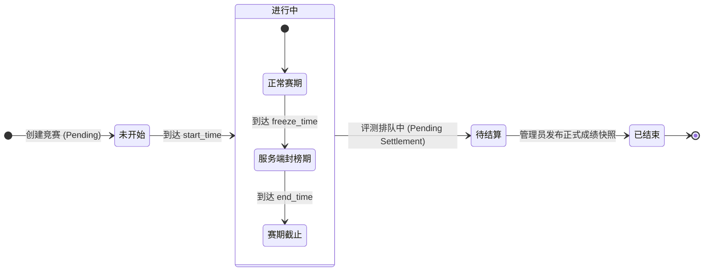
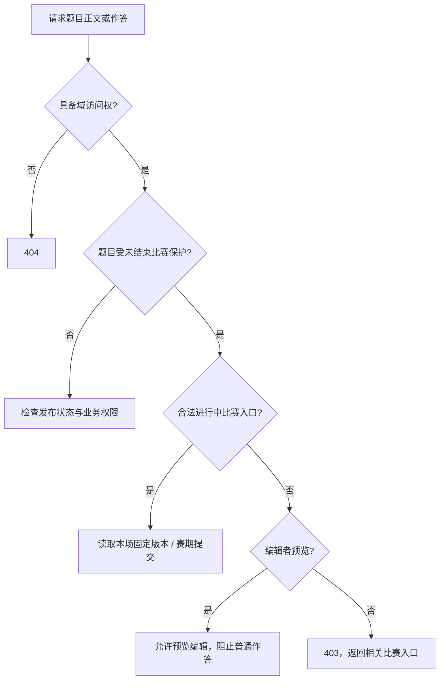

# 竞赛系统（Contests）

Neuro OJ 深度适配 AI 认证与数据科学竞赛，内置专为模型评测打造的**类 Kaggle
分数赛**模式。系统具备毫秒级实时榜单推送、题目按比赛保密、多级封榜隔离以及赛后成绩快照发布等企业级赛事保障机制。

---

## 赛制与评分模型

当前竞赛系统原生支持 **Kaggle 分数赛** 模式（`type='kaggle'`）。

### 1. 核心计分规则

- **最高分累加**：每道竞赛题配置独立满分。参赛者在赛期内可多次提交（代码、客观题套卷或
  ZIP
  产物），系统**仅保留该参赛者在各题的最高有效得分**，各题最高分之和即为最终总分。
- **提交次数限制（`submission_limits`）**：主办方可针对各题单独配置提交次数上限。未单独配置的题目不限制提交次数。
  ::: warning 评测失败亦计入提交次数
  为防止利用异常错误旁路试探用例分布，**评测失败（如超时 TLE、运行时错误
  RE、空产物）同样会计入已用提交次数**。参赛者应在本地或练习模式充分验证后再向比赛提交。
  :::
- **同分判定（Tiebreaker）**：当两位参赛者总分相同时，**率先达到该最高总分的时间戳较早者排在前面**。

---

## 竞赛生命周期与流转

竞赛生命周期经过状态机的严格时序控制，确保赛前题面零泄露、赛中公平竞争与赛后平稳复盘：

### 状态阶段与入口

比赛属于一个 Domain。用户先取得该域的访问权，再按当前比赛状态报名、查看赛题和提交。
比赛不再区分邀请赛与公开赛，也不再使用独立的比赛密码或邀请码。
域的邀请用于加入域；班级关联用于教学发现与统计，不替代域访问权限。

## 比赛保密

创建比赛时默认开启 `secrecy_enabled`。主办方可在开赛前调整；开赛后锁定。
关闭保密适合使用已有练习题的训练赛；报名、赛期受理、计分和封榜仍独立生效。

开启保密的题目从**加入比赛**起，直到比赛到达 `end_time` 都受到保护，涵盖其全部历史版本。
题库、题单、作业和搜索仍展示题号、标题及灰色斜纹保密标记；普通入口不返回题面、
样例、模板、附件或可泄露题面内容的搜索摘要。访问正文返回
`403 CONTEST_PROBLEM_RESTRICTED`，并提供相关比赛入口。没有域访问权时仍返回 404。

- **赛前**：普通用户不能读取正文或通过练习、作业、自测等入口作答。
- **赛中**：已报名者通过本场比赛入口读取固定版本并提交。服务端校验比赛、域、
  报名关系、赛期和题目版本；仅添加 `contest_id` 参数不会获得授权。
- **管理预览**：拥有本域题目编辑权限者可以预览和编辑；普通提交及自测同样被阻止。
  管理权限不会把练习提交变成比赛提交。
- **赛后**：到达结束时间即解除本场保护，与正式成绩快照是否发布无关。
  如果另一场尚未结束的保密比赛仍包含该题，普通入口继续受保护。
- **重叠比赛**：合法的进行中比赛入口可访问本场固定版本；已结束比赛入口不能绕过另一场保护。

个人原提交和已有成绩按原有私人数据权限保留；读取题面和新的作答行为仍检查当前保护。
私信、作业反馈、他人代码与答案、测试数据及 Provider 密钥继续按各自权限管理。
比赛期间的答疑默认仅提问者与出题组可见，主办方可将通用澄清公开为比赛公告。

---

## 榜单可见性与服务端封榜

### 1. 榜单可见性范围（`ranking_visibility`）

主办方可为赛事设定三种基础可见性：

- `public`：获域访问权的访客可查看公开排行榜；
- `participants`：仅已成功报名的参赛选手登录后方可查阅；
- `hidden`：全员隐藏，赛前及赛中均不公布榜单。

::: warning 赛期只显示本人排名
无论 `ranking_visibility` 取何值，竞赛**进行中**（含封榜期）以及赛后**待结算**期间，普通用户打开榜单都**只能看到自己这一行**，看不到其他选手的成绩；榜单页会显示相应提示。这是防止赛中泄露他人实时成绩的设计，不是数据缺失。管理员发布正式成绩快照后，按上述可见性范围开放完整榜单。
:::

### 2. 服务端绝对封榜保护（Freeze）

为制造终局悬念并遏制抄袭，平台支持在比赛结束前开启封榜。配置方式二选一：

- 指定封榜绝对时间戳：`freeze_start_time`；
- 指定结束前相对封榜时长：`freeze_duration_seconds`。

::: info 封榜期间的关键安全设计

1. **冻结视图（Frozen View）**： 在封榜窗口期内，普通用户通过 REST API 或 SSE
   读取的榜单数据被严格固化在封榜开始前的瞬间，**任何后续提交产生的分数变化都不会泄漏给任何普通用户**。
2. **零泄漏隐私原则**：
   封榜并不意味着公开全量明细。非特权用户查阅榜单时，服务端接口**始终仅返回当前登录选手本人的排名行**；未登录者获取空列表；只有管理员可查阅实时完整榜。
3. **旁路分析与 SSE 脱敏**： 封榜期间，针对普通选手的全局提交 SSE
   广播中，**强行剔除 `user_id` 与 `submission_id`**，仅广播全局脱敏事件（仅携带
   `problem_id`）。任何用户无法通过网络监听逆向推导竞争对手的提交频次与解题进度。
   :::

---

## 成绩结算与正式发布

比赛到达 `end_time`
后，系统不会立刻向普通参赛者公开全量终榜，而是进入**待结算（Pending
Settlement）**阶段：

1. **等待队列清空**：等待赛期最后一秒提交的超大任务或复杂评测在 Docker
   沙箱中全部执行完毕；
2. **反作弊与异常排查**：主办方在管理后台按题目复核代码相似度线索（IP
   关联分析已于 2026-09-28 下线）；相似度只作为人工复核线索，不会自动处罚，详见下文
   [代码相似度复核与申诉](#代码相似度复核与申诉)；
3. **发布正式快照（Publish
   Snapshot）**：管理员核准无误后，点击「发布正式成绩快照」。此时系统固化正式获奖名单与全员排名，全站开放赛后复盘与公开榜单查阅。

### 代码相似度复核与申诉

赛后主办方可能会对同一题目、同一语言的提交做代码相似度比对。选手需要了解：

- **判定依据**：工具忽略注释、空白、字符串内容与变量命名差异，比较代码结构片段的重合比例（Jaccard 系数，默认 0.8 以上列为待复核）；
- **不会自动处罚**：被列入复核不等于被认定作弊，处置前主办方应通知当事选手并给出陈述机会；
- **申诉路径**：平台没有内置的相似度申诉工单，申诉渠道与时限以本场竞赛说明或赛事章程为准。申诉成立时，主办方会恢复成绩并重新发布成绩快照。

算法细节、阈值含义与主办方的标准处置流程见 [竞赛代码相似度：判定口径、处置与申诉](../operators/contest-similarity.md)。

---

## 主办方管理操作指南

管理员与比赛拥有者可在管理后台高效控制赛事全流程：

1. **创建与编排**：设置标题、起止时间、竞赛说明与参赛要求，选定题目列表并配置各题独立满分与提交配额；
2. **配置全局统计影响**：明确该比赛是否计入全站天梯积分（`affect_global_ranking`，默认关闭，避免练习赛扰乱全站天梯）；
3. **动态监控**：赛中通过后台实时榜单面板无视封榜限制监控全场提交波形与沙箱评测负载；
4. **成绩归档**：一键生成最终排名 CSV
   报表与代码打包下载，用于离线颁奖与存档备案。

---

## 兼容与弃用（0.11）

比赛不再区分公开赛与邀请赛，因此下列字段已从 API 与界面中移除：

| 字段 | 位置 | 现状 |
| --- | --- | --- |
| `kind`（`public` / `invite`） | 比赛响应与创建/更新请求 | 已移除；请求里带上会返回 `400 CONTEST_LEGACY_FIELD` |
| `is_public` | 同上 | 已移除；报名与可见性改由域访问权决定 |
| `has_password` | 比赛响应 | 已移除 |
| `password` | 报名与创建/更新请求 | 已移除；请求里带上会返回 `400 CONTEST_LEGACY_FIELD` |

数据库中的 `contests.kind` / `is_public` / `password` 三列暂时保留（写入恒为中性值），
它们**不参与任何授权判定**，将在后续迁移中删除。

旧的无域比赛入口（`/contests/**`、`/api/v1/contests/**`）保留 301 与默认域门控，
但已登记为**弃用**：新代码请使用 `/d/:slug/contests/**`，无域入口最早在 0.12 评估下线。
已退役的写接口仍返回 410，不在本表的弃用范围内。

### 无域读接口的下线评估（2026-10-31）

对 `rc/v0.11` 做了一次静态清点（门禁脚本 `scripts/check-legacy-contest-api.ts`），
结论是**现在还不能删，但已经没人用**：

| 项 | 现状 |
| --- | --- |
| 仍在服务的无域只读路由 | 8 条（列表、详情、赛题、单题、实时榜、正式榜、我的提交、答疑） |
| 无域写路由 | 5 条，全部已退役（生产返回 `410 ENDPOINT_RETIRED`） |
| 第一方生产调用方 | 仅 `editor/[id].vue` 与 `utils/editorHistory.ts` 的旧竞赛分支，**不可达** |
| 测试引用 | 37 处，全部在非生产环境的 E2E 里 |

三个必须知道的事实：

1. **退役只在生产启用。** 410 由 `retireLegacyEndpoints`（默认取
   `NOJ_ENV === "production"`）控制，因此 E2E 里旧写接口仍返回 201。**测试通过不是退役
   证据**，退役契约由门禁的静态断言保证：写方法必须全部登记在
   `retired-endpoints.json`。
2. **旧编辑器入口已收敛。** `/editor/:id?contest=<id>&label=<label>` 会被
   `legacy-contest-editor` 中间件在渲染前 301 到 `/d/main/contests/<id>/solve/<label>`。
   它原本的提交调用在生产环境已经是 410。
3. **授权口径绑默认域。** 无域读路径经 `resolveDefaultContestAccess`，固定 `main` 且
   拒绝其他域的比赛；旧入口不能"顺手"改成域无关。

0.12 下线的前置条件：删除 `editor/[id].vue` 的 `isContest` 分支与
`utils/editorHistory.ts` 的竞赛分支，清空 `scripts/check-legacy-contest-api.ts` 的
`CALLER_ALLOWLIST`，让无域读路由返回 410 并观察一个版本；同时决定 E2E 是否切到
`retireLegacyEndpoints: true` 运行。评估记录见
[`.agents/notes/implemented/architecture/2026-10-31-legacy-contest-api-retirement-assessment.md`](https://github.com/Neuro-OJ/neuro-oj/blob/65a4fb101d0759929b2cd75484fb3beac7174ba1/.agents/notes/implemented/architecture/2026-10-31-legacy-contest-api-retirement-assessment.md)。
