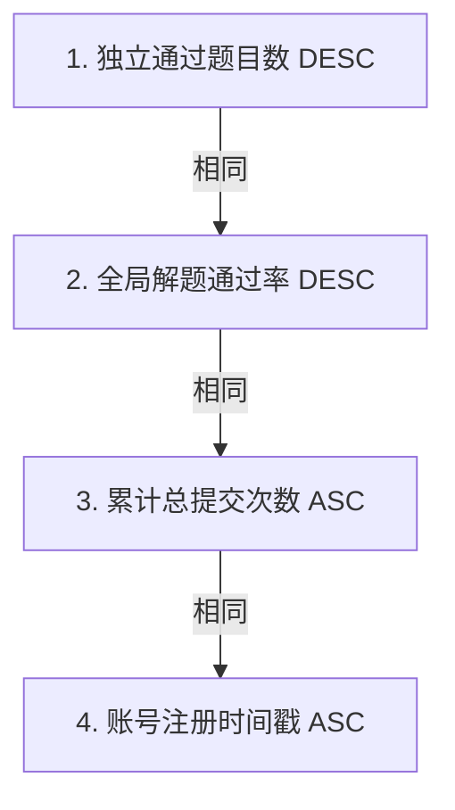
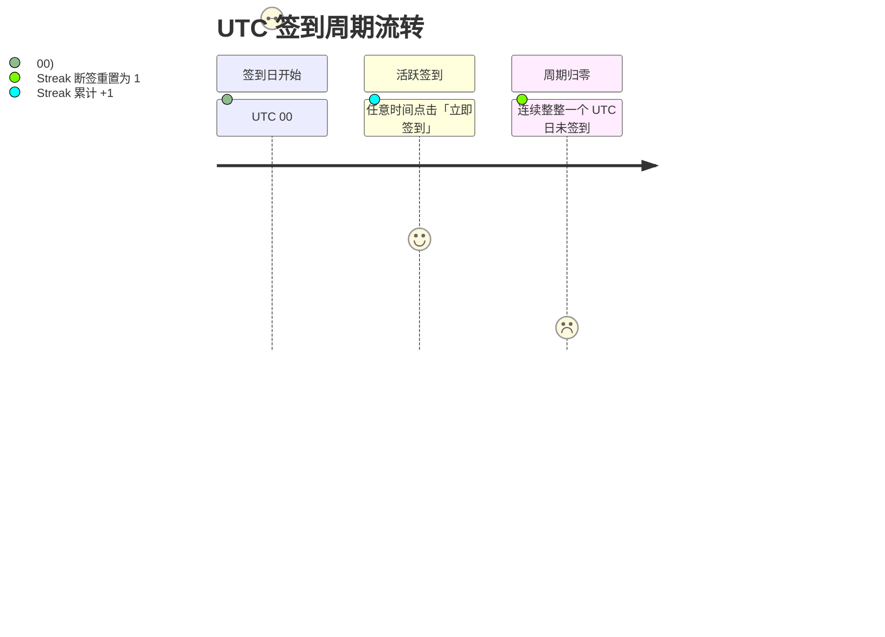

# 天梯榜单与每日签到（Ranking & Streak）

Neuro OJ 建立了全公开、高并发友好的天梯排名系统与基于 UTC
历法的每日打卡活跃度追踪机制，激励做题者持续精进算法与工程能力。

---

## 全站天梯排行榜

天梯榜单（路由 `/leaderboard`，旧地址 `/ranking` 自动跳转）面向公众**全开放查阅**，无需预先登录。

### 1. 榜单入围条件（Eligibility）

并非所有注册账号均出现在榜单中。上榜必须严格满足以下门槛：

- **有效通过门槛**：必须**至少独立通过 1 道题目**（获得 Accepted 终态）；
- **系统特权剔除**：平台 `root` 系统管理员账号自动剔除出榜，维护社区竞技公正；
- **竞赛题目隔离**：日常比赛中的提交默认**不计入全站天梯统计**，除非赛事主办方在创建时明确启用了
  `affect_global_ranking=true` 开关。

### 2. 四级精确排序算法与 Tiebreaker

当多名选手通过题目数相同时，系统依据严格定义的四级优先级实施仲裁排序：

| 排序优先级    | 指标键名                            | 排序方向         | 物理口径与业务考量                                                          |
| ------------- | ----------------------------------- | ---------------- | --------------------------------------------------------------------------- |
| **第 1 顺位** | 独立通过题数（`accepted_problems`） | **降序（DESC）** | 核心能力指标。同一道题目的重复通过不计入增量                                |
| **第 2 顺位** | 解题通过率（`ac_rate`）             | **降序（DESC）** | $\frac{\text{通过提交数}}{\text{总提交数}}$。体现代码调试成熟度与单次命中率 |
| **第 3 顺位** | 累计总提交数（`total_submissions`） | **升序（ASC）**  | 在题数相同的条件下，用更少试错次数解决题目的选手排名靠前                    |
| **第 4 顺位** | 账号注册时间（`created_at`）        | **升序（ASC）**  | 终极 Tiebreaker。更早加入社区的老选手优先排位                               |

### 3. 查询口径

榜单按当前域与授权范围直接查询有效成绩投影，不再依赖旧的全局物化视图：

- **域内查询**：只统计当前域绑定的已发布题目与有效提交，私有域记录不进入默认公开榜；
- **实时口径**：评测结果保存后即参与查询，没有旧视图刷新窗口带来的延迟；
- **分页与渲染**：默认每页展现 **50 名**（API 最大支持 100
  名），前三甲渲染金、银、铜尊贵奖章；登录选手打开榜单时，系统自动锁定并高亮本人的排位行。

---

## 每日签到与活跃度统计

平台在首页显著位置提供每日签到卡片，记录做题者的毅力与习惯养成：

### 1. 核心计算口径

- **统一 UTC 基准日**：签到判定严格以 **UTC 日期（零点刷新）** 为准，杜绝本地客户端时区篡改。

::: tip 时区换算注意事项
由于以 UTC 为准，**北京时间（UTC+8）早晨 00:00 至 08:00 仍属于前一个 UTC 自然日**。在此时间段内签到将记入前一日的统计中。
:::

- **纯粹的习惯追踪**：签到**不产出任何代币、积分或虚拟经验值**，仅精准维护连续打卡天数（Streak）。若中途遗漏一天，连续计数重归 1。

### 2. 个人主页 365 天活跃矩阵

进入个人主页的「活跃度」专栏，用户可直观审视自己的训练热度：

- **三维核心指标**：历史累计签到总天数、当前持续天数、历史最长连签天数；
- **贡献热力图日历**：前端固定呈现过去 **365 天（一年周期）**
  的渐变打卡热力图，方块颜色深度直接映照当日的勤奋足迹。

### 3. 签到活跃榜

在榜单页（`/leaderboard`）切换到「签到活跃榜」标签（`/leaderboard?board=checkin`），可查看按月统计的签到排行：

- **统计周期**：按 **UTC 自然月** 统计，默认当月；可通过左右箭头切换到历史月份（不可切到未来月份）；
- **排序规则**：当月签到天数降序，天数相同按用户名升序；
- **本人名次**：登录后页面右上角显示你在该月的名次（当月未签到则不显示）；
- **分页**：每页 50 名，前三名同样显示金、银、铜徽章，登录用户的行会高亮。

对应接口为 `GET /api/v1/rankings/checkin?month=YYYY-MM&page=1&per_page=50`，公开只读。

---

## 练习能力值（Best 30 Practice Rating）

在解题榜与签到活跃榜之外，平台为日常刷题与赛后补题提供纯能力导向的 **练习能力值（Best 30）**，并在个人主页与榜单页的「能力值榜」（`/leaderboard?board=practice-rating`）展示。

### 1. 计算公式（`b30-v1`）

- **题目难度分 $d \in [0, 100]$**：优先采用 `problem_difficulty.calibrated`（贝叶斯校准难度）；尚无校准数据时回退至出题人三档先验（`easy = 25`、`medium = 50`、`hard = 75`）。
- **单题满分潜能**：$B(d) = 50 + 2d + 0.025d^2$（范围 `50..500`，对应 `easy ≈ 116`、`medium ≈ 213`、`hard ≈ 341`、`d=100` 为 `500`）。
- **有效得分率 $r$**：
  - 非客观题（OI / AI 代码 / LLM / 预测 / 产物 / 界面题）：满分固定 `10000`（×100 整数口径），取该题有效最高分占比；
  - 客观题套卷：满分为作答版本小题数 × `100`；
  - 0 分提交不进入计算。
- **单题能力分**：$P = \lfloor B(d) \cdot r^{1.5} + 0.5 \rfloor$（刷新更高分自动抬升单题分，同时鼓励向高分/满分冲刺）。
- **Best 30 聚合**：取官方主域（`main`）公开题库中单题能力分最高的 **30** 道题求和（总分范围 `0..15000`）。凑满 30 题后，低难度水题无法挤进 B30，天然防刷水题。

### 2. 口径边界

- 仅统计官方主域已发布且绑定可用的公开题目（含日常练习与主域已结束比赛有效成绩）；私有域、教学域、团队域自建题目一律不计入；
- 处于未结束公开赛保密保护期的题目一律排除，赛后自动纳入；
- 练习能力值与未来的竞赛 Rating、每日签到、社区互动（评论/举报）及 LLM 配额完全解耦。

对应接口：

- `GET /api/v1/practice-rating/me`（当前登录用户能力值与 Top-30 构成明细）；
- `GET /api/v1/practice-rating/users/:id`（公开查询指定用户能力值与 Top-30 明细，支持 UUID 或 username）；
- `GET /api/v1/rankings/practice-rating?page=1&per_page=50`（公开只读能力值榜，登录时附带本人 `user_rank` 与 `user_rating`）。
