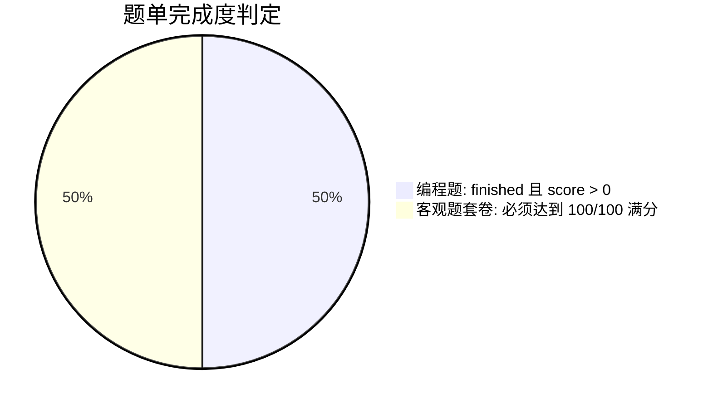

# 题单系统（Trainings）

题单（Training List）是 Neuro OJ
为专项集训、课程教学和阶段性备考打造的题集组织工具。通过题单，教师、出题组或自学者可将零散的试题串联成条理清晰、具备循序渐进梯度的学习路径。

---

## 归属、状态与权限

题单属于一个 Domain，访问范围由域的全局访问政策决定。题单不再区分私有、隐链和公开。
新建题单默认草稿，只有具备本域编辑权限的人可以维护；具备 `training:publish`
权限后可发布，域内获授权用户即可浏览。置顶仍需要对应管理权限。

## 创建与编排

1. 在当前域新建题单，填写标题和简介。
2. 添加本域已发布题目的数字题号，调整题目顺序；题目详情页也可快捷加入可编辑题单。
3. 保存草稿或发布。编辑已有题单会保留发布状态并校验 revision，避免覆盖他人的修改。

跨域资源先复制到本域。复制整份题单会递归复制题目，同一来源题去重，整批成功或整批失败。
目标副本只保留所选发布版本的内容和文件，不包含来源学生数据；来源更新与下架不影响副本。

被保密比赛保护的题目仍在题单中显示题号、标题和灰色斜纹标记，正文与普通作答受保护。
题目结束保护后自动恢复；详情见[比赛保密](./contests.md#比赛保密)。

---

## 进度统计与达标条件

题单详情页会自动聚合当前用户的完成情况，以可视化进度条呈现学习进展：

| 题目类型         | 记为通过（Completed）的标准                  | 说明与判定哲学                                                                     |
| ---------------- | -------------------------------------------- | ---------------------------------------------------------------------------------- |
| **算法与编程题** | 提交终态为 `finished` 且有效得分 `score > 0` | 在部分分机制下，取得有效突破即视为推进阶段性训练（出题人亦可结合赛制设立专项门槛） |
| **客观题套卷**   | 卷面得分达到 **100 / 100 满分**              | 客观题考察精确知识点记忆与理解，需全对即为掌握                                     |

---

## 管理员治理职责

在后台管理界面的「题单管理」模块，管理员可执行全生命周期治理：

- **域内检索与编辑**：浏览、修改获授权域的题单的元信息与题目编排；
- **官方认证与置顶**：将高质量社区题单发布 并开启 `is_pinned`
  置顶展示；
- **违规清理**：对包含广告、违规引流或侵权内容的题单执行一键封禁与物理删除。
