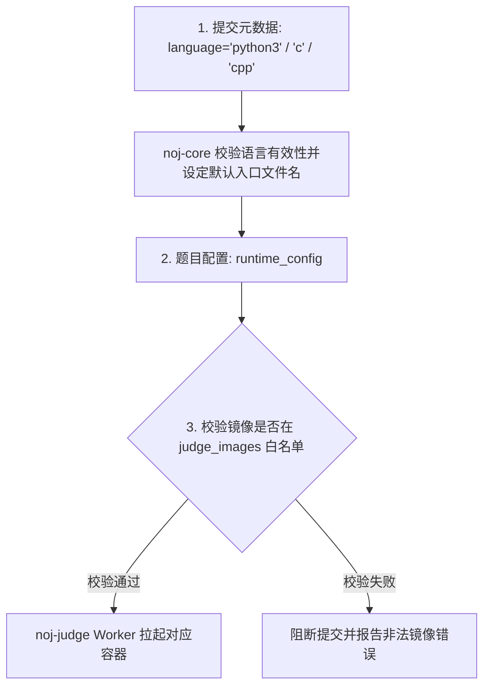

# 评测镜像与沙箱运行时（Runtimes）

在 Neuro OJ 中，所有评测工作均被封装在纯净的 Docker
容器镜像内执行。系统建立了三层运行时配置模型，依托严格的镜像白名单与沙箱隔离策略，为
AI 模型训练与算法评测提供安全、确定性的执行环境。

---

## 运行时架构与语言选型准则

Neuro OJ 保留面向 AI 题目的 Python 双容器模式，同时提供传统 OI 题的独立
`judge_type: "oi"` 模式。两种模式共享提交队列与结果协议，但不共享题目运行配置：

- `dual`：Evaluator + Solution 双容器，面向 Python/LLM 题；
- `oi`：固定 C/C++ 工具链执行，题包只在 worker
  侧读取输入与标准答案，并在本机受限 Docker 沙箱镜像（默认 `noj-oi-cpp`）中编译、运行及执行 checker。

---

## 运行时三层派生模型

评测任务在从提交到落入 Docker 执行的过程中，经过三层清晰的模型解析：



1. **第 1 层：提交语言标识（Language Identifier）**：客户端提交时携带的
   `language` 字段。双容器题使用 `/workspace/main.py`；OI 题按语言使用
   `/workspace/main.c` 或 `/workspace/main.cpp`，编译器与入口由 worker 固定；
2. **第 2 层：题目运行时配置（`runtime_config`）**： 题目出题人在 Web 编辑器或
   `problem.json` 中明确声明 Evaluator 与 Solution 分别使用的具体镜像名称、CPU
   配额、内存配额以及 Evaluator 的启动指令（缺省为
   `python3 /workspace/evaluate.py`）；
3. **第 3 层：镜像白名单与纵深防御（Whitelist & Prefix Verification）**：
   - **业务层准入**：`noj-core` 在创建或更新题目时，比对 `judge_images`
     数据库注册表；
   - **沙箱层熔断**：`noj-judge` 评测机在从 Redis
     队列取出任务启动容器前，使用宿主环境变量 `JUDGE_IMAGE_PREFIX`
     对目标镜像名称实施**二次前缀白名单校验**，阻断非官方镜像执行。

---

## 官方标准评测镜像矩阵

## prediction 单容器运行时

**预测提交（prediction）题**是唯一**不创建 Solution 容器**的路径。选手提交的是单个预测数据文件（纯数据，不是代码），平台不执行任何不可信代码，因此只需一个 Evaluator 容器：

- 只创建 `noj-evaluator-python` 容器（`cap_drop ALL` / 默认无网 / `pids_limit` / CPU 上限 / readonly rootfs + tmpfs `/workspace`），**绝不创建 Solution 容器**，也没有 NDJSON 编排。
- 支持包 zip 注入 Evaluator `/workspace`（`evaluate.py` + 隐藏标签）。
- 预测文件以**流式注入**写入 `/workspace/prediction/<原始文件名>`，该目录下只有这一个文件。
- Judge Worker 向 Evaluator exec 注入两个环境变量：

  | 环境变量 | 值 | 说明 |
  |----------|-----|------|
  | `NOJ_PREDICTION_DIR` | `/workspace/prediction` | 预测文件所在目录 |
  | `NOJ_PREDICTION_FILE` | 选手上传的文件名 | 预测文件名 |

- `/workspace` 大小由 `runtime_config.evaluator.workspace_size_mb` 决定；缺省取 Judge Worker 的 `JUDGE_PREDICTION_WORKSPACE_MB`（默认 `2048`，单位 MB）。两者都被收敛到 **512–16384** 范围（题目级越界值在 judge 侧 clamp）；管理员可用 `judge_max_prediction_workspace_mb` 设置项（`JUDGE_MAX_PREDICTION_WORKSPACE_MB`，0 = 不限制）再收一层上限，超限的出题请求在保存时即 400。大预测文件会以 tmpfs 形式占用 Worker 内存。
- 输出解析与双容器一致：Evaluator stdout 出现 `---RESULT---` 后取下一非空行 JSON `{score, details}`；stdout/stderr 全文受 1 MiB 硬上限约束，标记检测为流式（不依赖滚动缓冲重扫）。
- prediction 题**不配置 `solution`**：题目的 `runtime_config` 可省略 `solution`，提交时语言固定为 `python3` 占位。
- 预测文件复用 `artifact_storage_url` 生命周期：与产物一致，保留到提交被显式删除，可按版本任务重测；对象缺失时重测条目以 `ARTIFACT_MISSING` 失败并保留原成绩。

出题约定见[出预测提交题](../problemsetters/prediction-problems.md)。

镜像由 `noj-judge/scripts/build-sdk-images.sh` 构建（默认 tag `:latest`，与 noj-core 种子数据 `judge_images` 登记一致）。
官方提供经过裁剪与安全加固的标准基础镜像（通过
`noj-judge/scripts/build-sdk-images.sh` 脚本统一部署构建）：

| 镜像标识                   | 运行类别       | 预装依赖与适用场景                                                                                                 |
| -------------------------- | -------------- | ------------------------------------------------------------------------------------------------------------------ |
| **`noj-evaluator-python`** | Evaluator 容器 | 包含出题人 SDK（`noj_evaluator_sdk`）、标准测试工具库与 HTTP 客户端，用于运行 `evaluate.py`                        |
| **`noj-solution-python`**  | Solution 容器  | 轻量级 Python 运行时，内置 `noj_solution_sdk.host` 协议服务，适用于绝大多数标准算法与客观推理题                    |
| **`noj-solution-ai`**      | Solution 容器  | **数据科学与机器学习专享沙箱**。预装 CPU 版 PyTorch、NumPy、Pandas、Scikit-learn、OpenCV 与 SciPy 等科学计算全家桶 |
| **`noj-oi-cpp`**           | OI 容器        | GCC/G++ C99/C++11 编译器；每个测试点使用一次性非 root、无网络容器                                                  |

## OI 题包配置

OI 题包的 `problem.json` 使用以下核心字段；`subtasks` 分数总和必须为 100，子任务
只有其全部测试点通过时才得分，依赖失败的子任务记为 `IGN`：

```json
{
  "format_version": 3,
  "kind": "oi",
  "title": "A+B",
  "runtime_config": {
    "backend": "native",
    "languages": ["c", "cc"],
    "time_limit_ms": 1000,
    "memory_limit_mb": 256,
    "checker": { "type": "default" },
    "subtasks": [{
      "id": "all",
      "score": 100,
      "cases": [{ "input": "tests/1.in", "output": "tests/1.out" }]
    }]
  }
}
```

`default` checker 按 Hydro 兼容的 token 比较，`strict` 按字节比较，`testlib`
使用 题包中的受信 checker 源码并在隔离 checker sandbox 中以
`checker input output answer` 参数运行。输入、输出和 checker 路径会在题包导入时
做路径穿越与存在性校验；题目版本不单独保存，重测时读取题目的最新配置和支持包。
题包辅助文件分为 `user_extra_files`（选手编译/运行可见）、`compile_extra_files`
（用户与 checker 编译可见）和 `checker_extra_files`（仅 checker sandbox
可见）；导入 Hydro 题包时，`user_extra_files` 与 `judge_extra_files`
分别保留在对应的用户和 checker 范围。题目配置最多包含 100 个测试点，测试点总时限上限为 60000ms。

---

## 产物提交（Kaggle 模式）运行时特征

针对提交离线训练成果（如预测结果 CSV、微调模型权重或生成策略代码）的题目：

- **ZIP 解包交付**：选手上传打包的 `.zip` 成果，评测宿主自动解压至 Solution
  沙箱工作区 `/workspace`；
- **统一入口约定**：系统一律以约定入口 **`python3 /workspace/submission.py`**
  启动选手程序；
- **存储保留与重测**：选手上传的 ZIP 产物保留至提交被显式删除，支持管理员按版本重测（对象缺失时重测条目记为 `ARTIFACT_MISSING` 并保留原有有效成绩）。

---

## 常见运行时排错索引

| 异常现象                              | 核心根因定位                                                                                             | 权威解决方案                                                                                               |
| ------------------------------------- | -------------------------------------------------------------------------------------------------------- | ---------------------------------------------------------------------------------------------------------- |
| 提交立即显示 **`error`**，无评测日志  | 题目配置的 Docker 镜像未在宿主机预先拉取，或未被录入 `judge_images` 白名单表                             | 在评测宿主机执行 `bash scripts/build-sdk-images.sh` 构建基础镜像，并核实题目 `runtime_config` 镜像名称拼写 |
| OI 提交显示 `SE`                      | Worker 未安装固定 OI Docker 镜像或 checker 沙箱返回系统错误              | 检查 `JUDGE_OI_IMAGE` 与评测机 Docker 镜像状态；不要把题目命令或镜像写入提交消息                          |
| 导入 `torch` 报 `ModuleNotFoundError` | 题目未配置使用 AI 专用镜像                                                                               | 出题人在题目配置中将 Solution 镜像切换为 `noj-solution-ai`                                                 |
