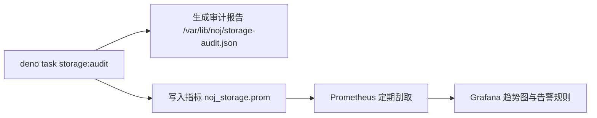

# 对象存储生命周期治理（Object Storage Governance）

随着平台比赛频次与题目规模的增长，题目支持包、选手产物提交、用户头像等对象持续落盘。Neuro
OJ
建立了严谨的**只读对象盘点基线与对账治理机制**，旨在防止脏数据堆积，同时避免误删正在被引用的关键资产。

---

## 阶段原则：只读盘点，零自动破坏

::: danger 黄金红线：孤儿对象（Orphan）绝不等于"可直接删除"
盘点工具报告中识别出的孤儿对象仅代表**当前数据库业务主表没有直接引用它**。由于跨环境引用、历史容灾备份回放窗口或刚刚上传但尚未提交表单的草稿状态，**严禁运维人员写脚本批量执行物理 `DELETE`**！直接删除存储桶或目录可能导致生产数据永久丢失。
:::

系统当前实施**纯只读对账策略**：

- 仅执行数据库 `SELECT` 汇总与对象存储 `LIST` 遍历；
- 输出对象计数、容量占用、孤儿对象与悬挂引用（Missing References）；
- 绝对不主动调用对象存储的 `DeleteObject` 接口，保持生产只读安全。

---

## 对象类型与引用映射字典

| 对象资产类别       | 数据库主表关联字段                     | 标准 Key 路径模式                               | 当前生命周期治理策略                                               |
| ------------------ | -------------------------------------- | ----------------------------------------------- | ------------------------------------------------------------------ |
| **题目纯净评测包** | `problems.support_package_storage_url` | `packages/<problem_id>.zip`                     | 仅在出题人更新题包或物理删除题目时由业务代码事务清理               |
| **选手产物提交包** | `submissions.artifact_storage_url`     | `artifacts/<uuid>.zip`                          | 默认长期保留供下载与重测；开启分层保留（`ARTIFACT_RETENTION_ENABLED=true`）或执行 `storage:retention --apply` 后按等级受控解绑并走引用守卫回收 |
| **用户自定义头像** | `users.avatar_url`                     | `avatar/<user_id>.<ext>`                        | 用户更换或移除头像时，在确认无多处引用的前提下清理历史版本         |
| **站内私信图片**   | 无（私信已于 #698 下线）               | `message-images/<conversation_id>/<uuid>.<ext>` | 不再有引用，`storage:audit` 盘点时计为孤儿，人工复核后清理         |
| **系统备份快照**   | 独立快照 Manifest（不在业务表）        | `backups/` 归档前缀                             | 遵照运营者灾备保留周期策略手动或归档脚本清理                       |

---

## 只读盘点运维执行指南

运维人员可通过 `noj-core` 内置的治理工具生成全量盘点审计报告：

```bash
cd noj-core
deno task storage:audit -- --pretty \
  --output /var/lib/noj/storage-audit.json \
  --prometheus-output /var/lib/node_exporter/textfile/noj_storage.prom
```

该工具会输出结构化 JSON 汇总，并向 Prometheus Node Exporter 导出指标：



---

## 核心可观测性指标与告警阈值

| Prometheus 指标项                            | 采集类型 | 业务监控含义与告警水位                                              |
| -------------------------------------------- | -------- | ------------------------------------------------------------------- |
| **`noj_storage_objects_total`**              | Gauge    | 当前存储桶内对象总数统计                                            |
| **`noj_storage_bytes`**                      | Gauge    | 当前存储桶消耗的实际物理字节数                                      |
| **`noj_storage_orphan_objects`**             | Gauge    | 数据库无记录但存储中存在的孤儿对象数                                |
| **`noj_storage_orphan_bytes`**               | Gauge    | 孤儿对象占用的总磁盘空间                                            |
| **`noj_storage_missing_references`**         | Gauge    | **🚨 致命告警项**：数据库记录存在但存储中文件丢失（必须严格等于 0） |
| **`noj_storage_audit_generated_at_seconds`** | Gauge    | 盘点任务最后成功执行的时间戳，用于探活治理定时任务                  |

### 🚨 必须人工介入挂起的异常场景

1. **`missing_references > 0`**：说明发生了非预期的文件丢失，已有题目或提交无法找到支持包，必须立即排查存储介质；
2. **孤儿对象在短时间内暴增**：通常表明选手批量上传产物题后任务队列阻塞或任务退场异常；
3. **盘点目标环境不匹配**：若部署配置的 Bucket
   名称或存储驱动填写错误，将得出完全虚假的 Missing 报警，需优先核实环境变量。

---

## 产物分层保留与受控回收（Artifact Tiered Retention）

在维持“只读盘点不盲删孤儿”红线的前提下，针对高频增长的选手产物包（`submissions.artifact_storage_url`），系统提供了**默认关闭（opt-in）、分级保护、引用守卫**的分层保留清理机制：

| 保护等级 | 命中范围 | 默认策略 |
| -------- | -------- | -------- |
| **Tier 0（绝对保护）** | 在途评测提交（`pending`/`judging` 或有 `active_attempt_id`）；进行中竞赛提交及竞赛结束后 **7 天赛后宽限期**内提交 | **永久跳过，绝不清理** |
| **Tier 1（最佳/通过产物）** | 题库通过（`is_accepted`）、竞赛通过（`is_contest_accepted`）或竞赛当前有效成绩（`contest_effective_attempt_id` 非空） | 由 `ARTIFACT_BEST_RETENTION_DAYS` 控制（默认 **`0` = 永久保留**） |
| **Tier 2（普通非最佳产物）** | 其余已终结（`finished`/`error`）非最佳产物提交 | 由 `ARTIFACT_NON_BEST_RETENTION_DAYS` 控制（默认 **14 天**） |

### 安全清理与重测语义

- **完整保留提交与成绩记录**：清理仅在行锁事务内将过期提交的 `submissions.artifact_storage_url` 置为 `NULL`，**不删除**提交行、分数与历史尝试记录；
- **引用守卫物理删除**：事务提交后调用 `deleteStorageObject()`；若升级副本或内容寻址去重仍引用同一对象，自动保留物理文件；确认零引用后物理删除并自动释放对应域的存储配额（`releaseDomainStorageObject`）；
- **过期产物重测兜底**：管理员对产物已清理的旧提交发起重测/升级时，任务条目以稳定错误码 `ARTIFACT_MISSING`（"产物对象已超过保留期被清理，保留历史判定"）优雅失败并保留原成绩。

### 配置项与运维命令

```bash
# bootstrap 环境变量（需重启 noj-core 生效）
ARTIFACT_RETENTION_ENABLED=true          # 默认 false（关闭自动后台清理）
ARTIFACT_NON_BEST_RETENTION_DAYS=14      # 非最佳产物保留天数（0 = 禁用）
ARTIFACT_BEST_RETENTION_DAYS=0           # 最佳/通过产物保留天数（0 = 永久保留）

# 手动预演（默认 --dry-run，只读不修改 DB 与对象存储）
cd noj-core
deno task storage:retention -- --pretty

# 确认预演结果后显式执行有限批次清理
deno task storage:retention -- --apply --batch 100 --pretty
```
